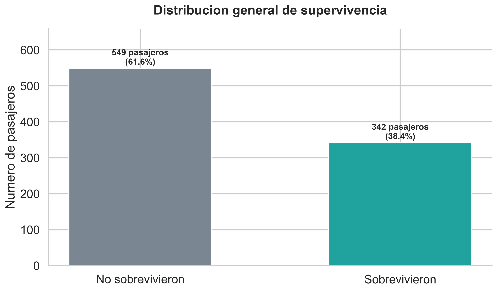
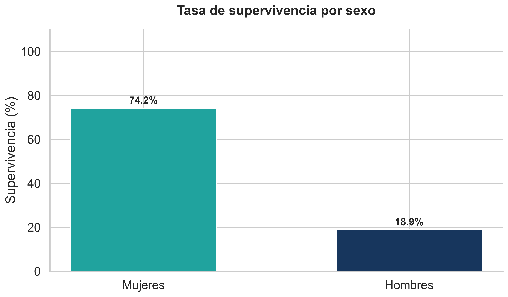
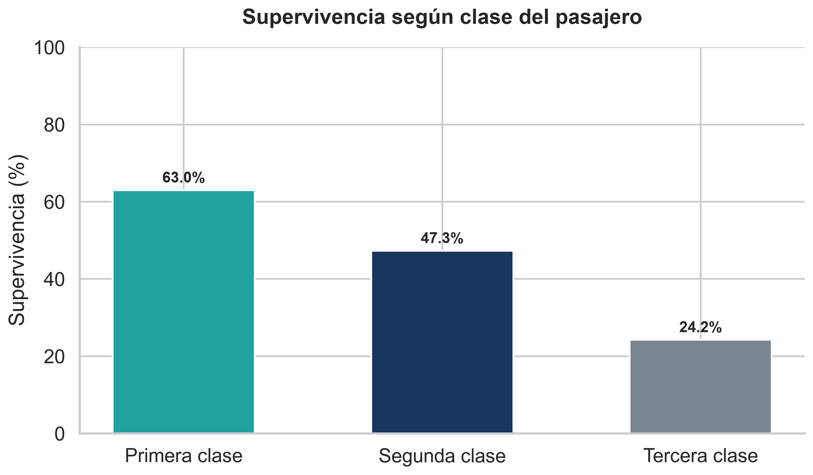
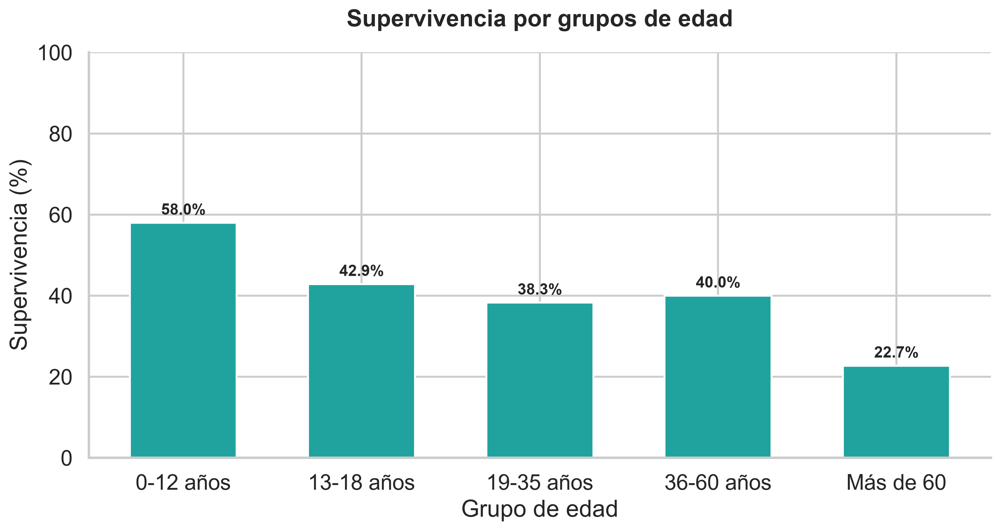
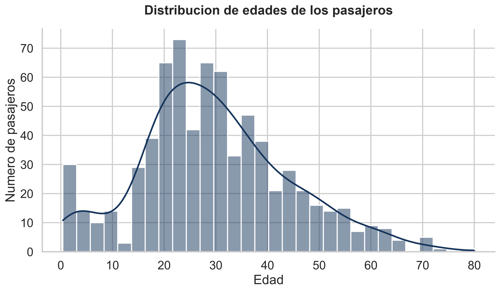

# Titanic Machine Learning | Python Data Analysis & Prediction

**End-to-end Machine Learning project using Python, Pandas and Scikit-learn to explore passenger data, compare classification models and predict survival outcomes in the Kaggle Titanic competition.**

---

# 🇬🇧 English Version

## 1. Project Overview

This project explores the Titanic passenger dataset to identify factors associated with passenger survival and develop classification models to predict survival outcomes.

The workflow covers data inspection, exploratory data analysis, data preprocessing, model training, model comparison, hyperparameter optimization and prediction generation.

The objective is to demonstrate practical skills in Python, data analysis and introductory Machine Learning.

## 2. Project Objectives

- Inspect and understand the original dataset.
- Identify missing values and data quality issues.
- Explore survival patterns across passenger characteristics.
- Prepare and transform data for machine learning.
- Train and compare classification algorithms.
- Optimize model parameters.
- Generate predictions for the Kaggle competition.

## 3. Technologies and Tools

| Technology | Application |
| :--- | :--- |
| Python | Main programming language |
| Pandas | Data manipulation and analysis |
| NumPy | Numerical operations |
| Matplotlib | Data visualization |
| Seaborn | Statistical visualization |
| Scikit-learn | Machine Learning |
| VS Code | Development environment |
| Kaggle | Dataset and competition |

## 4. Project Structure

```text
TITANIC-MACHINE-LEARNING/
│
├── data/                         # Created locally; excluded from Git
│   ├── raw/                      # Original Kaggle CSV files
│   └── processed/                # Processed datasets
│
├── images/
│   ├── 01_supervivencia_general.png
│   ├── 02_supervivencia_sexo.png
│   ├── 03_supervivencia_clase.png
│   ├── 04_supervivencia_edad.png
│   └── 05_distribucion_edades.png
│
├── notebooks/
│   ├── 01_revision_datos.py
│   ├── 02_analisis_exploratorio.py
│   ├── 03_preparacion_datos.py
│   ├── 04_entrenamiento_modelos.py
│   ├── 05_optimizacion_modelo.py
│   └── 06_generar_predicciones.py
│
├── outputs/
│   └── submission.csv
│
├── .gitignore
├── requirements.txt
└── README.md
```

**Data note:** The original and processed datasets are not included in this repository. The `data/raw/` and `data/processed/` folders are created locally when the project is run.

## 5. Exploratory Data Analysis and Visualizations

The exploratory analysis examines passenger survival, sex, passenger class and age distribution. The following charts were generated to support the analysis.

### General survival distribution



### Survival by sex



### Survival by passenger class



### Survival by age group



### Passenger age distribution



## 6. Data Preprocessing

The preprocessing stage includes:

- Identification of missing values.
- Extraction and grouping of passenger titles.
- Creation of the `FamilySize` feature.
- Creation of the `IsAlone` feature.
- Creation of the `HasCabin` feature.
- Removal of selected columns that are not used as model predictors.

The processed datasets are saved locally in `data/processed/`.

## 7. Machine Learning Models

Two classification algorithms were trained and evaluated:

- Logistic Regression
- Random Forest Classifier

The evaluation used an 80/20 stratified train-validation split with `random_state=42`.

### Model comparison

| Metric | Logistic Regression | Random Forest |
| :--- | ---: | ---: |
| Accuracy | 83.24% | 81.01% |
| Precision | 80.00% | 76.12% |
| Recall | 75.36% | 73.91% |
| F1-score | 77.61% | 75.00% |

Logistic Regression achieved the strongest validation results among the initial models and was selected as the primary model.

### Random Forest optimization

GridSearchCV was used to explore different Random Forest hyperparameter combinations.

Best parameters:

- `max_depth`: 10
- `min_samples_leaf`: 1
- `min_samples_split`: 2
- `n_estimators`: 100

Optimized Random Forest results:

| Metric | Result |
| :--- | ---: |
| Accuracy | 80.45% |
| Precision | 75.76% |
| Recall | 72.46% |
| F1-score | 74.07% |

The optimized Random Forest did not outperform Logistic Regression on the validation set.

## 8. Kaggle Submission

The final prediction script generates a submission file containing the passenger identifier and predicted survival outcome.

**Kaggle competition score: 0.77511**

Output file:

`outputs/submission.csv`

The Kaggle score is the result reported by the competition platform. It is separate from the validation metrics shown in the model comparison above.

## 9. Installation and Execution

### Requirements

- Python 3
- pip
- Git
- Visual Studio Code (recommended)

### Step 1. Get the project

After the repository is published, open it on GitHub and use **Code → Download ZIP**. Extract the downloaded folder and open it in VS Code.

If you prefer to use Git, open the repository's **Code** menu on GitHub, copy the clone URL and run `git clone` followed by that URL in PowerShell or your terminal.

### Step 2. Create a virtual environment

```bash
python -m venv venv
```

### Step 3. Activate the environment (Windows PowerShell)

```powershell
.\venv\Scripts\Activate.ps1
```

### Step 4. Install dependencies

```bash
pip install -r requirements.txt
```

### Step 5. Download the dataset

Download the required files from the Kaggle Titanic competition and place them in the local `data/raw/` folder:

- `train.csv`
- `test.csv`
- `gender_submission.csv`

Create the folders if they do not exist:

```powershell
New-Item -ItemType Directory -Force data/raw
New-Item -ItemType Directory -Force data/processed
```

The dataset is not included in this repository. Obtain it directly from Kaggle and follow the competition's rules and data-use conditions.

### Step 6. Run the scripts

Run the following commands from the project root, in this order:

```powershell
python notebooks/01_revision_datos.py
python notebooks/02_analisis_exploratorio.py
python notebooks/03_preparacion_datos.py
python notebooks/04_entrenamiento_modelos.py
python notebooks/05_optimizacion_modelo.py
python notebooks/06_generar_predicciones.py
```

## 10. Skills Demonstrated

- Python programming fundamentals.
- Data inspection and cleaning.
- Exploratory Data Analysis (EDA).
- Feature engineering.
- Data visualization.
- Classification algorithms.
- Model evaluation and comparison.
- Hyperparameter optimization.
- Prediction generation.
- Project organization and documentation.

## 11. Author

**Edgar Fabián Cabrera Bardales**

Junior Data Analyst | Python | SQL | Power BI | Data Analytics

---

# 🇪🇸 Versión en español

## 1. Descripción del proyecto

Este proyecto analiza el conjunto de datos de pasajeros del Titanic con el objetivo de identificar factores relacionados con la supervivencia y desarrollar modelos de clasificación capaces de predecir los resultados.

El flujo de trabajo incluye revisión de datos, análisis exploratorio, preparación de información, entrenamiento y comparación de modelos, optimización de parámetros y generación de predicciones.

El objetivo principal es demostrar conocimientos prácticos de Python, análisis de datos y fundamentos de Machine Learning.

## 2. Objetivos

- Examinar y comprender los datos originales.
- Identificar valores nulos y problemas de calidad.
- Analizar patrones de supervivencia según las características de los pasajeros.
- Preparar y transformar los datos.
- Entrenar y comparar algoritmos de clasificación.
- Optimizar los parámetros de los modelos.
- Generar predicciones para la competición de Kaggle.

## 3. Tecnologías utilizadas

| Tecnología | Aplicación |
| :--- | :--- |
| Python | Lenguaje principal |
| Pandas | Manipulación y análisis de datos |
| NumPy | Operaciones numéricas |
| Matplotlib | Visualización de datos |
| Seaborn | Visualización estadística |
| Scikit-learn | Machine Learning |
| VS Code | Entorno de desarrollo |
| Kaggle | Datos y competición |

## 4. Análisis exploratorio y visualizaciones

Se analizaron diferentes características de los pasajeros, incluyendo supervivencia, sexo, clase y distribución de edades.

Se generaron cinco gráficos para facilitar la interpretación de los datos y comunicar los principales resultados.

### Distribución general de supervivencia


### Supervivencia según el sexo


### Supervivencia según la clase del pasajero


### Supervivencia según el grupo de edad


### Distribución de edades de los pasajeros


## 5. Preparación de datos

El proceso de preparación incluye:

- Identificación de valores ausentes.
- Extracción y agrupación de títulos de los pasajeros.
- Creación de la variable `FamilySize`.
- Creación de la variable `IsAlone`.
- Creación de la variable `HasCabin`.
- Eliminación de determinadas columnas que no se utilizan como variables predictoras.

Los datos preparados se guardan localmente en `data/processed/`.

## 6. Entrenamiento y comparación de modelos

Se entrenaron dos algoritmos de clasificación:

- Regresión Logística (Logistic Regression).
- Bosque Aleatorio (Random Forest).

La evaluación se realizó utilizando una división estratificada del 80 % para entrenamiento y 20 % para validación, con `random_state=42`.

### Comparación de resultados

| Métrica | Regresión Logística | Random Forest |
| :--- | ---: | ---: |
| Accuracy | 83,24 % | 81,01 % |
| Precision | 80,00 % | 76,12 % |
| Recall | 75,36 % | 73,91 % |
| F1-score | 77,61 % | 75,00 % |

La Regresión Logística obtuvo los mejores resultados entre los dos modelos iniciales y fue seleccionada como modelo principal.

### Optimización de Random Forest

Se utilizó GridSearchCV para evaluar distintas combinaciones de parámetros.

Mejores parámetros encontrados:

- `max_depth`: 10
- `min_samples_leaf`: 1
- `min_samples_split`: 2
- `n_estimators`: 100

Resultados del modelo optimizado:

| Métrica | Resultado |
| :--- | ---: |
| Accuracy | 80,45 % |
| Precision | 75,76 % |
| Recall | 72,46 % |
| F1-score | 74,07 % |

La optimización no consiguió superar los resultados de la Regresión Logística en el conjunto de validación.

## 7. Resultados en Kaggle

El script final genera un archivo de predicciones con el identificador de cada pasajero y el resultado estimado de supervivencia.

**Puntuación obtenida en Kaggle: 0.77511**

Archivo generado:

`outputs/submission.csv`

Esta puntuación corresponde al resultado comunicado por la plataforma Kaggle y es independiente de las métricas de validación de los modelos.

## 8. Instalación y ejecución

Para reproducir el proyecto:

1. Descargar el repositorio desde GitHub y abrir la carpeta en VS Code.
2. Crear un entorno virtual de Python.
3. Instalar las dependencias de `requirements.txt`.
4. Descargar los archivos de la competición Titanic desde Kaggle.
5. Colocar los archivos CSV en `data/raw/`.
6. Crear `data/processed/` si no existe.
7. Ejecutar los seis scripts en el orden indicado en la sección de instalación en inglés.

Los datos originales y procesados no están incluidos en el repositorio; se generan o guardan localmente durante la ejecución.

## 9. Conocimientos demostrados

- Fundamentos de programación con Python.
- Inspección y limpieza de datos.
- Análisis exploratorio de datos.
- Ingeniería de características.
- Visualización de información.
- Algoritmos de clasificación.
- Evaluación y comparación de modelos.
- Optimización de hiperparámetros.
- Generación de predicciones.
- Organización y documentación de proyectos.

## 10. Autor

**Edgar Fabián Cabrera Bardales**

Junior Data Analyst | Python | SQL | Power BI | Data Analytics
